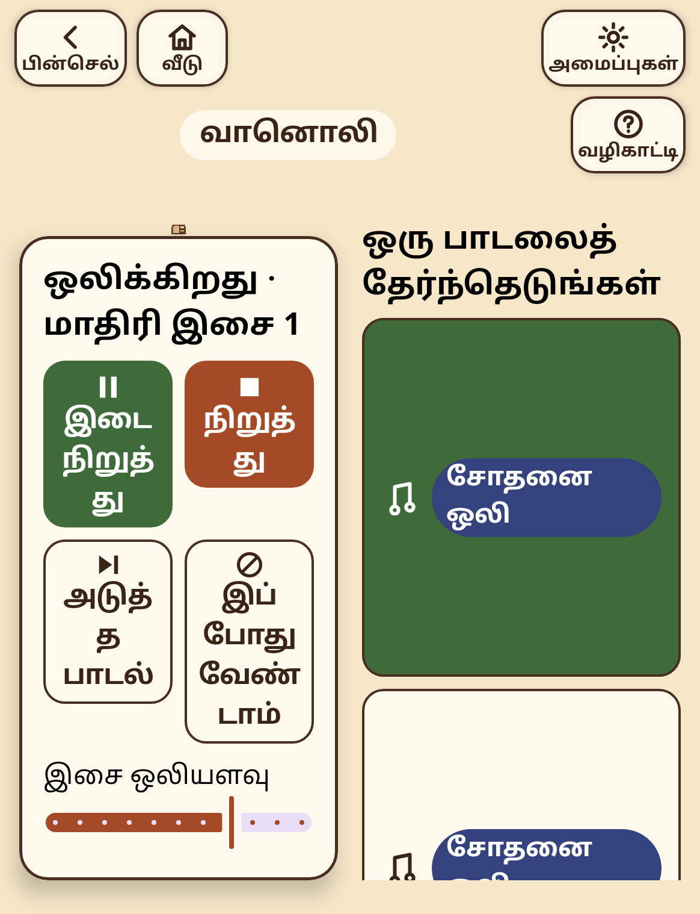
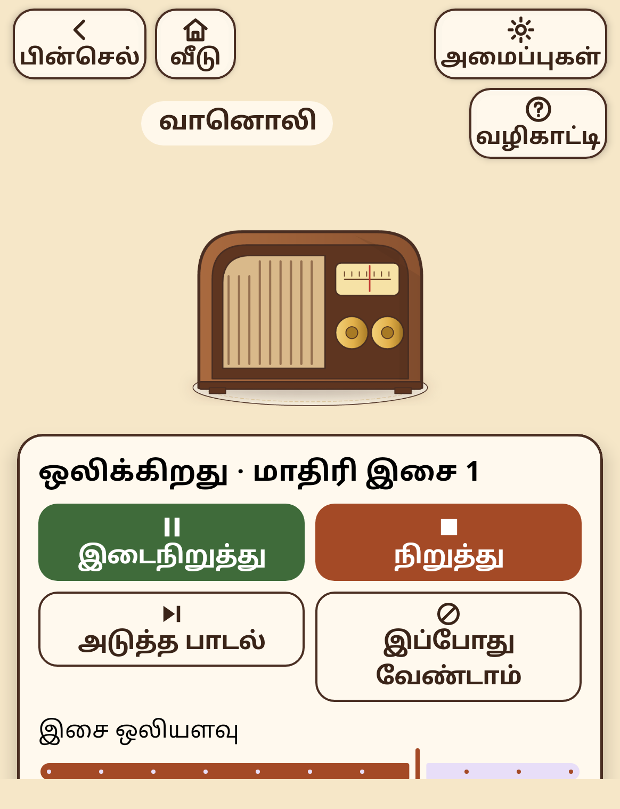

# SMRITI flagship technology: from SCOPE (NO-GO) to SMRITI Fit

**Status:**
- SCOPE is frozen as research: NO-GO under both its v1 and v2 protocols.
- SMRITI Fit, an explicit-needs presentation solver, passed its pre-registered **v2** gates on synthetic and rendered instances. It is integrated into the radio screen **behind a flag that is off by default**, because the pre-registered real-render default rule (V6) was not met.
- No people were involved, and no clinical claim is made.

| Document | Contents |
|---|---|
| [RESEARCH_REPORT.md](RESEARCH_REPORT.md) | SCOPE evidence, five alternatives with citations, matrix, choice |
| [FIT_SPEC.md](FIT_SPEC.md) | Design, model, safety |
| [FIT_PROTOCOL.md](FIT_PROTOCOL.md) → [FIT_EVAL_RESULTS.md](FIT_EVAL_RESULTS.md), [FIT_VALIDATION.md](FIT_VALIDATION.md) | v1: F1–F4 pass, **F5 FAIL → NO-GO** |
| [FIT_PROTOCOL_v2.md](FIT_PROTOCOL_v2.md) → [FIT_EVAL_RESULTS_v2.md](FIT_EVAL_RESULTS_v2.md), [FIT_VALIDATION_v2.md](FIT_VALIDATION_v2.md) | v2: **all gates pass → GO** |
| [FIT_V6_REAL_RENDER.md](FIT_V6_REAL_RENDER.md) | In-app Fit vs current layout on real renders: default rule **not met** |
| [FIT_FONT_CHECK.md](FIT_FONT_CHECK.md), [FIT_VALIDATION_v2_DEV_seeds9001-9060.md](FIT_VALIDATION_v2_DEV_seeds9001-9060.md), [FIT_DEV_RESULTS.md](FIT_DEV_RESULTS.md), [FIT_DEV_RESULTS_v2.md](FIT_DEV_RESULTS_v2.md) | Diagnostics and development runs |
| [FIT_DEMO.md](FIT_DEMO.md), [img/](img/) | Demo scenario |

## 1. What Fit does

SMRITI's screens turn the person's settings (text size on top of the system font scale, language, reduced motion) and the window size into a layout using fixed width thresholds (600, 380, 900, 420 dp …). Fit replaces those thresholds with a small, exhaustive, deterministic search:
- It enumerates at most 960 presentation configurations per screen: top-bar rows, top-bar label size, button width cap, button columns, icon beside or above the label, picture on or off, landscape split, and text level (never above what was asked for).
- It rejects any configuration that breaks a hard constraint: an essential control hidden or squeezed, the top bar covering content, a touch target below the minimum, a word broken mid-word, a label over two lines, the place name cut, a text-size need, reduced motion, or a person's lock.
- It picks the best remaining one by a fixed preference order: text closest to the size asked, keep the picture, fewest changes from last time, fewest rows, then icon beside the label.
- It explains each change against the design as drawn, using a counterfactual ("2 columns would break 'இடைநிறுத்து' mid-word: needs 160 dp, has 61 dp").
- If nothing fits, it relaxes constraints in a declared order and reports what remains. It never silently clips.

It uses **no learning, no behavioural data and no questions**. Its only inputs are existing settings and the window size, and a reflection test pins those input fields.

## 2. Results

**Benchmark** (protocol v2; 5,000 fresh synthetic instances from real strings and the bundled fonts, held-out content):

| Policy | Any layout violation | Hidden control / overlap | Text deficit (levels) | Picture kept |
|---|---|---|---|---|
| B1 current app rules | 56.6% | 30.9% | 1.096 | 74.7% |
| B2 rules + greedy checker-in-the-loop repair (same knobs) | 20.9% | 20.1% | 0.411 | 57.5% |
| **Fit** | **8.8%** (0% on the 87.8% of instances where any layout can meet every need) | **5.7%** | **0.301** | 69.0% |

- **Paired bootstrap CIs:** Fit vs B1 −47.9 points [46.5, 49.2]; Fit vs B2 −12.2 points [11.2, 13.1]. Text deficit vs B2: 0.110 levels less [0.085, 0.135].
- **Trade-off:** Fit keeps the picture less often than the current rules (69% vs 75%), because B1 keeps it even when that hides controls.
- **Latency:** p95 10.5 ms per decision on the JVM.

**Model validity (F5, fresh seeds 19001–19100):** the app's real radio screen was rendered by Robolectric (native graphics, SDK 34) for 100 instances. The model's predictions for the current rules agree with what is on screen in **965/1000 = 96.5%** of (instance, check) pairs.

**v1 history (kept):** v1 F5 *failed* (84.5%). The diagnosis found:
- a broken instrument check (`hasVisualOverflow` is true for every one-line title);
- an undetected failure mode (Compose squeezes rows instead of hiding them);
- a wrong model assumption (the spec assumed linear font scaling; Android 14 scales non-linearly up to ×2.0 and linearly above).

Text measurement itself was ruled out: AWT and Android `Paint` agree within ±1%. All of this was fixed under a new protocol committed before fresh runs.

**In the app (V6, same 100 instances, real renders):**
- **current layout: 53/100 instances with an on-screen problem; Fit: 13/100.**
- In **4 instances Fit shows a problem the current layout does not**, so the pre-registered rule keeps Fit **off by default**.
- Diagnosed cause (seeds 19065 and 19078 inspected): the model assumes the portrait picture is `min(220, (w − 112) × 0.75)` dp tall. In the app it is always 220 dp (`heightIn(max = 220.dp)` with a fill-size image), so on phones narrower than about 405 dp the model underestimates by up to 34 dp, and Stop can fall below the fold. Fixing it needs a new protocol and a fresh V6. It has **not** been done.

**Problems this work found in the current app** (from real renders):
- Widths 600–623 dp: the top bar switches to two rows (its own width is the window minus 24 dp), but content is reserved for one row, so the top bar **overlaps content** (5 observed instances).
- The radio screen decides "landscape" from its own box under the top bar, not the window. A 582×759 window gets the two-column landscape layout, with Tamil words broken into syllables (seed 9051, `img/9051_current.png`).
- System font ×1.5 with in-app LARGER (2.1) is scaled **linearly** by Compose (18 sp → 37.8 dp), which is larger than system ×2.0 alone (30 dp).
- Landscape phones: rows of a non-scrolling column are squeezed, so labels are clipped and the second row of buttons disappears (seed 9031, `img/9031_current.png`).

## 3. Status

| Part | Status |
|---|---|
| Solver, constraints, preference order, explanations, locks, relaxation, best effort | **Implemented**, unit-tested (`fit/`, 17 tests) |
| Persistence and deterministic replay (`FitState`, fail-closed decoding) | **Implemented and tested.** *Not* wired to the app's save file |
| Geometry model of the top bar + activity panel (from the app's Compose constants, measured non-linear font scaling) | **Implemented.** Validated against real Compose rendering for the **radio screen with the current rules** (96.5%) |
| Benchmark vs current rules and greedy repair | **Simulated** (synthetic instances, real strings and fonts). Generated panels for "new activities" are an assumption |
| In-app radio screen driven by Fit | **Implemented behind `FitFlags.radioEnabled` (off)**. Real-render comparison done (V6) |
| Locks UI, explanation UI, need-vs-preference and minimum-target settings in the app | **Proposed** (the solver supports them; the app has no such settings yet) |
| Other screens (Memory Book, travel, market, cooking) | **Proposed** |
| Device (not Robolectric) captures, TalkBack, people living with dementia | **Not done** |

## 4. Demo scenario

Same radio screen, same strings. Tamil, in-app text LARGER, 582×759 window. Left: current rules. Right: Fit.

| Current rules | Fit |
|---|---|
|  |  |

The current rules break "இடைநிறுத்து" into "இடை / நிறுத் / து", shrink the picture to a speck and squash the song list. Fit uses one scrolling column: words are intact, the picture is kept, and every control meets its minimum size.

`./gradlew :fit-bench:runFitDemo` prints the solver's decisions and reasons for five profiles and a lock (`FIT_DEMO.md`).

## 5. Commands

```sh
./gradlew :fit:test :fit-bench:test        # 17 + 4 unit tests (solver, persistence, baselines, real fonts)
./gradlew :fit-bench:runFitEval            # protocol v2 benchmark → FIT_EVAL_RESULTS_v2.md (about 1 min)
./gradlew :fit-bench:runFitDemo            # FIT_DEMO.md
./gradlew :app:testDebugUnitTest --tests "app.smriti.fit.*" -Dfit.validation=true   # F5 + V6 + font checks (rewrites the v2 docs; several minutes)
./gradlew :app:testDebugUnitTest --tests "app.smriti.fit.FitValidationTest.demoScreenshots" -Dfit.validation=true -Proborazzi.test.record=true   # img/
```

The v1 results are reproducible from the v1 code at commit `f11b561`.

## 6. Claim

> On the radio screen of a bilingual Tamil–English app, choosing the layout by exhaustive search over explicit accessibility constraints reduced rendered layout problems from 53 to 13 of 100 synthetic device and settings combinations, compared with the existing hand-written thresholds. The search is checked against the app's real fonts and Compose rendering, and it uses no behavioural data.

What this does **not** show:
- any benefit for people living with dementia or any clinical effect;
- that Fit is better on every instance (in 4 of 100 it was worse, because of a known model error);
- that the idea is new (SUPPLE, Gajos and Weld, is the precedent).
